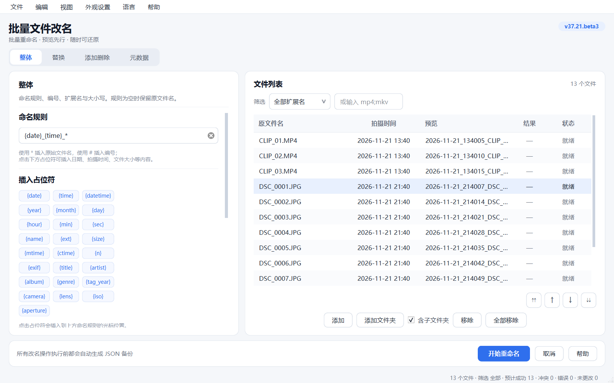
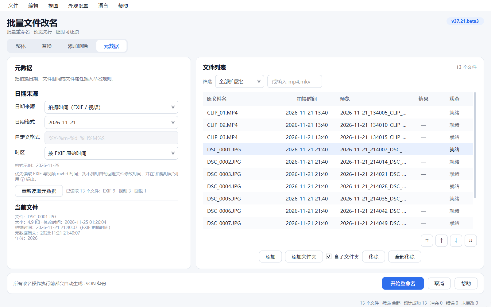
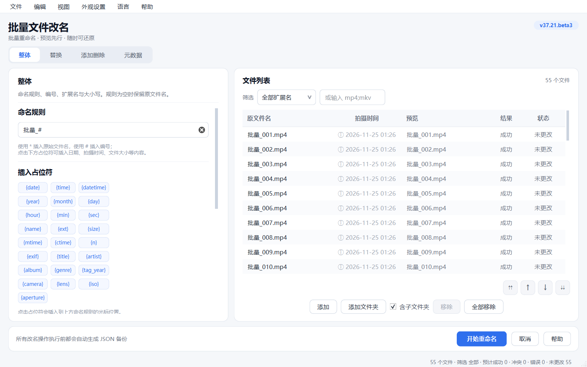
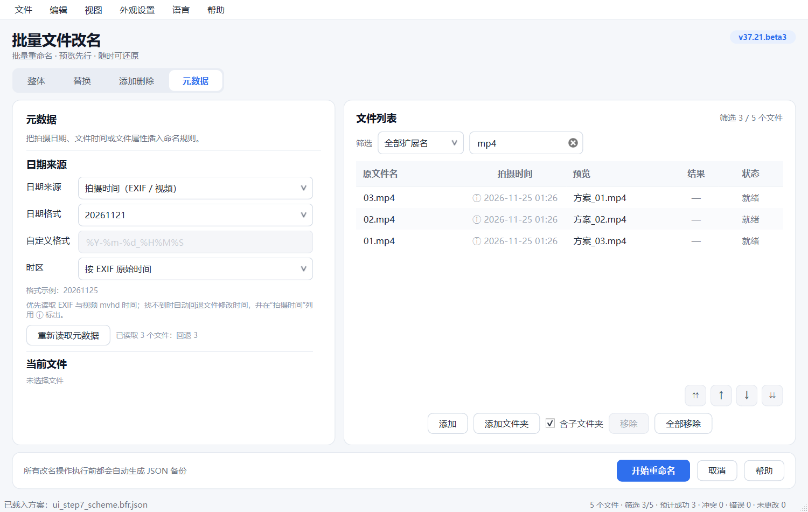
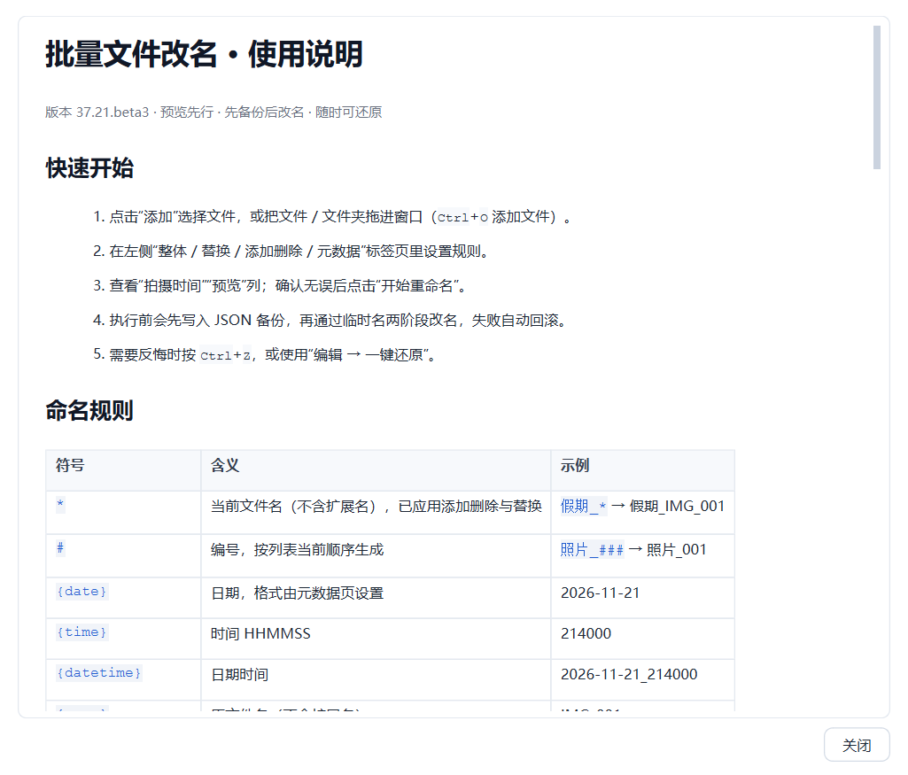
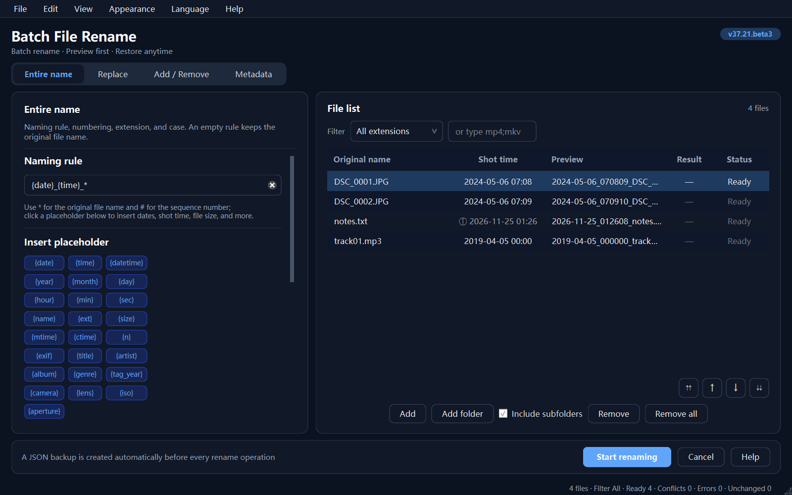
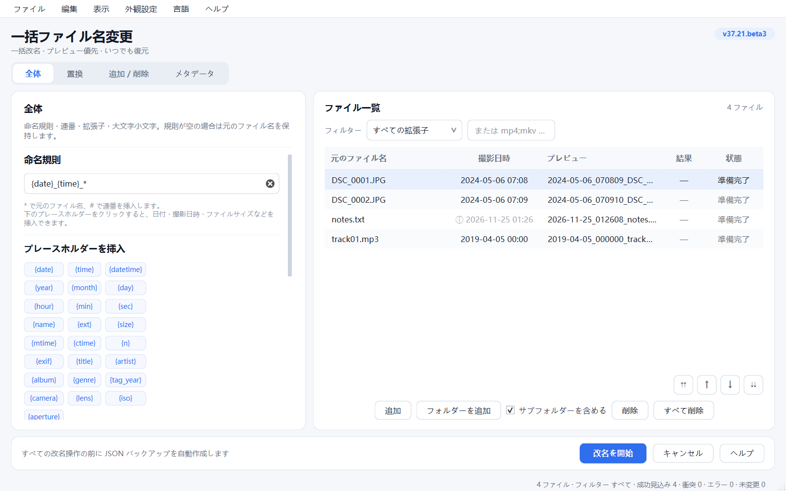

# 批量文件改名

Windows 桌面批量重命名工具。预览先行，改名前后均有备份，可撤销、可一键还原。

> **本软件使用 DeepSeek 开发**：需求拆解、源代码、测试、文档与打包均在 DeepSeek AI 编程助手协助下完成，作者负责验收与发布。
> 当前版本 **v37.21.beta3**：多语言、媒体标签、外观主题与文件夹扫描已加入。
> 规则编辑、拍摄时间、后台预览、安全改名、撤销 / 一键还原、方案导入导出与配置记忆均已可用。

## 下载

- **GitHub Releases**：<https://github.com/shoula3721/batch-file-renamer/releases>
  - `批量文件改名.exe`：单文件免安装版
  - `批量文件改名.zip`：单目录版压缩包
- 也可以下载源码后按下方“本地运行”启动。

## 当前进度

| 步骤 | 内容 | 状态 |
|---|---|---|
| 1 | 项目骨架、现代界面外壳、单文件 / 单目录双打包 | ✅ 已完成 |
| 2 | 命名引擎 + 单元测试（111 个用例全部通过） | ✅ 已完成 |
| 3 | 备份 JSON、两阶段执行、撤销、一键还原、崩溃恢复（165 个用例） | ✅ 已完成 |
| 4 | 现代 UI 完整还原、文件列表、筛选、排序与基础预览（181 个用例） | ✅ 已完成 |
| 5 | EXIF / 视频元数据、后台预览、拍摄时间列与来源提示（214 个用例） | ✅ 已完成 |
| 6 | 执行闭环、结果弹窗、撤销 / 还原界面、崩溃恢复入口（217 个用例） | ✅ 已完成 |
| 7 | 方案导入导出、配置记忆、离线帮助、最终打包（226 个用例） | ✅ 已完成 |

## v37.21.beta3 新增

- **多语言**：中文（默认）/ English / 日本語，顶部“语言”菜单即时切换，离线帮助同步本地化。
- **媒体标签重命名**：图片 EXIF（相机、镜头、ISO、光圈）、XMP、PNG iTXt；
  音频 ID3 / APE / Vorbis Comment（标题、艺术家、专辑、年份、风格）；
  视频 MP4/MOV 标签（标题、导演/Artist、录制日期、系列/Album）。
- **添加文件夹（含子文件夹）**：文件列表工具栏新增按钮与“包含子文件夹”开关，可只添加顶层文件。
- **外观设置**：白天 / 夜间 / 跟随系统（默认），跟随系统时会响应 Windows 主题切换。
- **重置为默认设置**：一键恢复默认规则、外观、语言、筛选、排序与窗口布局，不删除文件或备份。
- **版本**：v37.21.beta3（测试 240 个用例）。

## 开发环境

- Windows 10 / 11
- Python 3.10+（本项目在 3.13.17 下开发）
- 依赖见 `requirements.txt`（含 PySide6、Pillow、mutagen、PyInstaller、pytest）

```bat
python -m venv .venv
.venv\Scripts\python.exe -m pip install -r requirements.txt
```

## 本地运行

```bat
.venv\Scripts\python.exe main.py
```

调试辅助参数：

```bat
:: 启动后自动退出，用于验证环境
.venv\Scripts\python.exe main.py --smoke-test

:: 启动后截图并退出
.venv\Scripts\python.exe main.py --screenshot build\ui.png

:: 第 8 步演示：多语言、主题、媒体标签、文件夹扫描与重置默认
.venv\Scripts\python.exe build\ui_step8_demo.py

:: 第 7 步演示：方案导入导出、最近方案、配置记忆与离线帮助
.venv\Scripts\python.exe build\ui_step7_demo.py

:: 第 6 步演示：55 个文件真实改名、撤销、还原、崩溃恢复并截图
.venv\Scripts\python.exe build\ui_step6_demo.py

:: 第 5 步演示：生成带 EXIF / mvhd 的示例文件、检查拍摄时间并截图
.venv\Scripts\python.exe build\ui_step5_demo.py

:: 第 4 步的界面联调脚本（仍可使用）
.venv\Scripts\python.exe build\ui_demo.py
```

## 构建

```bat
:: 两种产物一起构建
build\build_all.bat

:: 或分别构建
build\build_onefile.bat
build\build_onedir.bat

:: 也可以直接调用
.venv\Scripts\python.exe build\build.py --target all
```

产物：

| 路径 | 说明 |
|---|---|
| `dist\批量文件改名.exe` | 单文件免安装版（约 45–55 MB） |
| `dist\批量文件改名\` | 单目录版（约 115 MB，启动更快） |
| `dist\批量文件改名.zip` | 单目录版压缩包 |

重新生成图标：

```bat
.venv\Scripts\python.exe build\make_icon.py
```

## 目录结构

```
├─ main.py                 入口（高 DPI、QSS、冒烟测试参数）
├─ app/
│  ├─ main_window.py       主窗口、菜单、状态栏、预览调度与后台线程接线
│  ├─ paths.py             资源路径 / 用户数据目录
│  ├─ i18n.py              多语言运行时与控件翻译
│  ├─ i18n_data.py         中 / 英 / 日翻译表
│  ├─ ui/                  界面层
│  │  ├─ rules_panel.py    四个规则标签页（含元数据设置）
│  │  ├─ file_list.py      文件模型、筛选、排序、移动、拖放、拍摄时间列
│  │  ├─ theme.py          浅色 / 深色 / 跟随系统
│  │  ├─ preview.py        按目录分组生成预览与拍摄时间来源
│  │  ├─ preview_worker.py 后台预览线程（带进度、可取消）
│  │  ├─ operations.py     后台改名 / 撤销 / 还原任务线程
│  │  ├─ progress_dialog.py 执行进度与取消
│  │  ├─ result_dialog.py  结果汇总、失败详情、直接撤销
│  │  ├─ restore_dialog.py 备份列表与一键还原
│  │  ├─ help_dialog.py    离线使用说明
│  │  └─ widgets.py        通用卡片 / 提示组件
│  ├─ engine/              命名引擎、元数据与方案（零 Qt 依赖）
│  │  ├─ rules.py          规则模型 + JSON（含 MetadataRule）
│  │  ├─ namer.py          命名流水线 + 冲突规划
│  │  ├─ validate.py       校验 / 长路径 / 序号分配
│  │  ├─ metadata.py       EXIF/XMP/PNG/ID3/APE/Vorbis/MP4 标签 + 缓存
│  │  ├─ scheme.py         .bfr.json 方案序列化与校验
│  │  ├─ backup.py         备份 JSON、状态机、清理
│  │  ├─ executor.py       两阶段临时名改名、回滚
│  │  └─ undo.py           撤销、一键还原、崩溃恢复
│  └─ resources/
│     ├─ app.ico           应用图标
│     ├─ help.html         离线帮助（中文）
│     ├─ help_en.html      离线帮助（English）
│     ├─ help_ja.html      离线帮助（日本語）
│     └─ style.qss         现代浅色主题（深色为调色映射）
├─ build/
│  ├─ build.py             构建脚本（onefile / onedir / zip）
│  ├─ build_all.bat        一键构建两种产物
│  ├─ make_icon.py         图标生成
│  ├─ crash_sim.py         崩溃注入（测试用）
│  ├─ ui_step5_demo.py     第 5 步演示与截图
│  ├─ ui_step6_demo.py     第 6 步改名/撤销/还原/恢复演示
│  ├─ ui_step7_demo.py     第 7 步方案/配置/帮助演示
│  ├─ ui_step8_demo.py     多语言/主题/媒体标签/文件夹/重置演示
│  └─ version_info.txt     exe 版本信息
├─ tests/                  单元测试（240 个用例）
├─ docs/                   界面截图（第 5–8 步）
├─ dist/                   构建产物
├─ requirements.txt
└─ 开发方案.md             完整需求与设计文档
```

## 界面（v37.21.beta3）
















- 顶部胶囊标签页：**整体 / 替换 / 添加删除 / 元数据**，全部规则控件已就位。
- 文件列表：原文件名、**拍摄时间**、预览、结果、状态五列；表头排序、上移 / 下移 / 置顶 / 置底。
- 添加文件、**添加文件夹（可选是否包含子文件夹）**、拖拽文件或文件夹、移除所选、全部移除。
- 扩展名筛选：下拉选择或手动输入 `mp4;mkv`，状态栏实时显示 `筛选 12/55`。
- 基础预览：按目录分组调用命名引擎，支持 `*`、`#`、`{date}` 等占位符与冲突自动加序号；筛选后编号按筛选结果重新从“开始于”生成。
- 整体页：命名规则、编号、扩展名与大小写；**占位符按钮位于命名规则下方**，点击即插入。
- 元数据页：日期来源 / 格式 / 自定义格式 / 时区；显示当前文件的时间、相机、镜头、标签信息；一键重新读取。
- 执行：进度对话框、取消、结果列、结果弹窗（失败原因与备份路径）、直接撤销。
- 备份与还原对话框：批次时间 / 类型 / 状态 / 成功失败数，冲突策略可选，双击即可还原。
- 方案：`Ctrl+S` 导出 `.bfr.json`，`Ctrl+Shift+O` 导入；“文件 → 最近方案”可快速载入。
- 多语言：顶部“语言”菜单支持中文 / English / 日本語，切换即时生效，帮助内容同步。
- 外观：顶部“外观设置”支持白天 / 夜间 / 跟随系统（默认），并记住选择。
- 重置：外观设置菜单中的“重置为默认设置”恢复规则、外观、语言、筛选与窗口布局。
- 配置记忆：窗口大小 / 位置、当前标签页、规则、筛选、排序与最近目录自动恢复。
- 离线帮助：`F1` 打开当前语言的内置帮助，不访问网络。
- 菜单与快捷键：`Ctrl+O` 添加、`Ctrl+Z` 撤销、`Ctrl+S` 导出方案、`F1` 帮助等。
- 状态栏：文件总数、筛选数量、预计成功、冲突、错误、未更改。

## 方案、配置与帮助（第 7 步已完成）

- **方案文件**：`.bfr.json`，包含全部规则（含元数据设置）、筛选扩展名与排序方式，
  带 `schema` 与 `app_version`；导入时校验版本与字段，损坏文件只提示、不影响当前设置。
- **不保存文件列表**：避免换目录或换机器后路径失效误改文件。
- **最近方案**：自动记住最近 8 个方案，可从“文件 → 最近方案”直接载入；文件丢失时给出提示并移除。
- **配置记忆**：通过 QSettings 保存窗口几何、当前标签页、规则参数、筛选与排序、最近目录、包含子文件夹开关；
  规则修改后 1 秒自动落盘，正常退出时再保存完整界面状态。
- **外观与语言记忆**：主题、语言分别保存在 `ui/theme`、`ui/language`，下次启动恢复。
- **离线帮助**：`app/resources/help.html`、`help_en.html`、`help_ja.html` 随程序打包，`F1` 打开。
- **版本信息**：exe 内嵌 37.21.beta3 版本信息，关于对话框显示 Python / PySide6 版本与备份目录。

## 多语言、外观与配置（v37.21.beta3）

- **语言**：中文（默认）、English、日本語，位于顶部“语言”菜单。
  界面静态文本在启动时翻译，动态消息通过模板匹配翻译；切换语言即时重绘菜单、标签页、列表与状态。
- **离线帮助**随语言切换：`help.html` / `help_en.html` / `help_ja.html`。
- **外观**：白天、夜间、跟随系统（默认）。夜间主题由浅色样式表按调色板映射生成，
  工具提示、表格、菜单、对话框与帮助页均适配；跟随系统时监听 Qt 颜色方案变化。
- **配置记忆**：主题、语言、规则、筛选、排序、窗口几何、标签页、最近目录和“包含子文件夹”开关。
- **重置为默认设置**：恢复默认规则与界面，清空最近方案，不删除文件、列表或备份 JSON。
- **多语言翻译表**：`app/i18n_data.py`，键为中文原文，英文 / 日文字典键集合一致；
  新增动态文本需同时在两个字典中补充带 `{占位符}` 的模板。

## 执行闭环（第 6 步已完成）

1. **开始重命名**
   - 点击后直接执行，不再弹出确认框；只处理当前筛选出的文件。
   - 预览未完成、存在错误项、名称未变化时分别提示或跳过，不会误改。
   - 执行前先写入 JSON 备份（含旧路径、新路径、大小、时间、规则快照）；
     备份失败则一个文件都不动。
2. **两阶段改名**：所有文件先改成同目录临时名，再落到目标名；
   单条失败立即回滚，绝不覆盖已有文件；执行在后台线程，带进度与取消。
3. **结果反馈**：结果列显示成功 / 失败 / 跳过，失败原因悬停可见；
   结果弹窗汇总数量、失败详情、备份文件，成功批次可直接“撤销本次重命名”。
4. **撤销**：`Ctrl+Z`、右键菜单或结果弹窗；把成功项按备份反向还原，
   原位置被占用时跳过；撤销本身也写入新的备份记录。
5. **一键还原 / 备份管理**：列出全部批次（时间、类型、状态、成功失败数、说明），
   默认选中最近可还原批次；冲突策略为“跳过”或“自动加 (1)”，不提供覆盖。
6. **崩溃恢复**：启动时发现 `preparing / renaming / incomplete` 批次会弹窗询问，
   确认后按备份里的临时名或新名称把文件还原到原路径，并汇总未解决的问题。
7. **防并发**：执行期间禁用列表、规则与关键菜单，禁止退出窗口；
   完成后恢复，并在关闭前确保后台线程结束。

演示脚本 `build/ui_step6_demo.py` 会真实改名 55 个文件，再依次验证撤销、
二次改名、备份还原和模拟崩溃恢复（全部自动断言），并生成上面第 6 步截图。

## 媒体标签与拍摄时间（第 5 步 + v37.21.beta3）

| 类型 | 读取内容 | 说明 |
|---|---|---|
| 图片 | EXIF 拍摄时间、相机型号、镜头、ISO、光圈 | Pillow；支持子秒、时区偏移；HEIC 等无解码器时回退 |
| 图片 | XMP（标题、创作者、日期、相机、镜头、ISO、光圈）与 PNG iTXt 文本 | 兼容 JPEG APP1 / PNG iTXt / EXIF tag 700 |
| 音频 | ID3、APE、Vorbis Comment：标题、艺术家、专辑、年份、风格 | 通过 mutagen 读取 MP3 / FLAC / OGG / APE / M4A 等 |
| 视频 | MP4/MOV 标签：标题、导演（Artist）、录制日期、系列（Album） | 结合 `moov/mvhd` 创建时间，mvhd 优先 |
| 其他 | 文件修改时间 → 文件创建时间 | 列表用灰色 **ⓘ** 标记回退，悬停显示原文 |

- 音频/视频的日期进入“拍摄时间”，日期来源选择“拍摄时间（EXIF / 视频）”时自动使用。
- 日期格式：`2026-11-21`、`20261121`、`2026-11-21_214000`、自定义 `strftime` 格式。
- 占位符：`{date}` `{time}` `{datetime}` `{year}` `{month}` `{day}` `{hour}` `{min}` `{sec}` `{name}` `{ext}` `{size}` `{mtime}` `{ctime}` `{n}` `{exif}` `{title}` `{artist}` `{album}` `{genre}` `{tag_year}` `{camera}` `{lens}` `{iso}` `{aperture}`，点击即插入到命名规则。
- `{artist}` 对视频表示导演，`{album}` 表示系列；`{aperture}` 为文件名安全写法（如 `f2.8`）。
- 时区：EXIF 通常无时区信息，保持原始值；视频 UTC 可“转换为本地时间”。
- 读取结果按 `(路径, mtime, 大小)` 缓存，文件变化自动失效；右键“重新读取拍摄时间”可强制刷新。
- 预览在后台线程执行，状态栏与元数据页显示读取进度；上千文件也不会卡住界面。
- 排序：`视图 → 按拍摄时间排序`，或直接点击“拍摄时间”表头切换升 / 降序。

## 命名引擎（第 2 步已完成）

`app/engine/` 不依赖 Qt，可独立测试：

| 文件 | 职责 |
|---|---|
| `rules.py` | 规则模型、7 种大小写选项、元数据设置、JSON 序列化（schema v1） |
| `namer.py` | 添加/删除、普通/正则替换、`*` `#` `{占位符}`、编号、冲突规划 |
| `validate.py` | 文件名拆分、非法字符/保留名/长度校验、长路径、冲突加序号 |
| `metadata.py` | EXIF / MP4 mvhd / 文件时间读取、缓存、占位符数据 |

测试：

```bat
.venv\Scripts\python.exe -m pytest
```

## 安全设计（第 3、6 步已实现）

1. **先备份再改名**：执行前写入
   `%APPDATA%\批量文件改名\backups\<时间>_<数量>.json`，`fsync` 成功后才允许改名。
   备份包含旧路径、新路径、大小、修改时间、规则快照、逐条状态。
2. **临时名中转**：所有文件先改成 `原名.~br_<批次>-<序号>.tmp`，再落到目标名，
   避免 `1.txt → 2.txt` 这类批量死锁；失败单条立即回滚。
3. **绝不覆盖**：全程 `os.rename`，不使用 `os.replace`；目标存在即失败并回滚。
4. **撤销 / 一键还原**：`Ctrl+Z` 或右键菜单；还原前预检冲突，默认跳过，不覆盖。
5. **崩溃恢复**：启动时发现 `preparing/renaming/incomplete` 批次，
   按备份里的临时名把文件还原到原路径。
6. **取消与并发**：进度对话框的取消只停止尚未处理的文件，已改名的仍可撤销；
   执行期间禁用列表、规则与退出，避免同时操作同一批文件。

已用真实进程 `os._exit` 在第 3 次和第 7 次改名时强制终止，重启后均能完整还原 5 个文件。

## 已知限制

- 配置保存在 Windows 注册表 `HKCU\Software\批量文件改名`；如需彻底重置，删除该键即可（不影响备份 JSON）。
- 执行期间窗口禁止退出；如果强制结束进程，下次启动会提示并恢复未完成的批次。
- 若在程序外手动删除了备份 JSON，残留的 `.~br_*.tmp` 临时文件需要手动处理（程序不会自动删除来源不明的文件）。
- 视频时间优先取 `mvhd` 创建时间；标签日期作为回退，不含子秒与时区偏移；部分相机会把本地时间写进 UTC 字段。
- `{aperture}` 使用文件名安全写法 `f2.8`（Windows 不允许 `/`），与界面提示的 `f/2.8` 等价。
- 多语言翻译由人工维护；遇到未翻译的第三方便捷提示或系统原生对话框，可在 `app/i18n_data.py` 补充。
- 深色主题不改变 Windows 原生标题栏；标题栏颜色由系统决定。
- HEIC / AVIF / RAW 的 EXIF 取决于 Pillow 解码器是否可用；读不到时回退文件修改时间并标注 ⓘ。
- 文件列表上限 10000 个；元数据首次读取为串行，超大列表首次预览需要几秒（有进度提示）。
- `dist\` 已用 v37.21.beta3 代码重建：单文件 52.5 MB、单目录 127.0 MB、zip 52.4 MB。单目录版与源码已冒烟验证；单文件版无法在当前开发沙箱内解压自检，请在普通桌面环境双击确认。
- 未签名 exe 可能触发 SmartScreen 提示；正式分发建议代码签名。

## 开发说明 / Built with DeepSeek

本软件 **使用 DeepSeek 开发**。

- 需求拆解、核心代码、单元测试、界面文案与打包脚本均在 **DeepSeek** AI 编程助手协助下完成。
- 作者负责需求确认、功能验收、发布与后续维护。
- DeepSeek 仅用于开发阶段；软件运行时不依赖 DeepSeek 服务，也不会上传文件或元数据。

更完整的说明见 [NOTICE.md](NOTICE.md)。

## 许可证

本项目使用 [MIT License](LICENSE) 开源。
Copyright (c) 2026 shoula3721.
