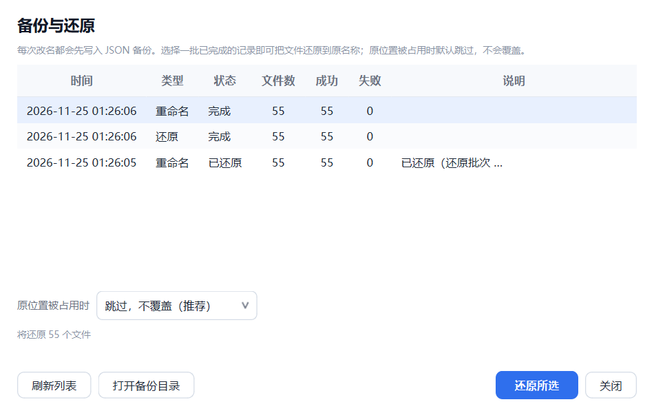

# 批量文件改名

Windows 桌面批量重命名工具。预览先行，改名前后均有备份，可撤销、可一键还原。

> **本软件使用 DeepSeek 开发**：需求拆解、源代码、测试、文档与打包均在 DeepSeek AI 编程助手协助下完成，作者负责验收与发布。

## 下载

- 源码仓库：<https://github.com/shoula3721/batch-file-renamer>
- **GitHub Releases**：<https://github.com/shoula3721/batch-file-renamer/releases/tag/v37.21.beta3>
  - [单文件免安装版](https://github.com/shoula3721/batch-file-renamer/releases/download/v37.21.beta3/BatchFileRenamer-v37.21.beta3.exe)（52.5 MB）
  - [单目录版压缩包](https://github.com/shoula3721/batch-file-renamer/releases/download/v37.21.beta3/BatchFileRenamer-v37.21.beta3-portable.zip)（52.4 MB）
- 也可以下载源码后按下方“本地运行”启动。

## 界面





## 开发环境

- Windows 10 / 11
- Python 3.10+（本项目在 3.13.17 下开发）
- 依赖见 `requirements.txt`（含 PySide6、Pillow、mutagen、PyInstaller、pytest）

```bat
python -m venv .venv
.venv\Scripts\python.exe -m pip install -r requirements.txt
```

## 已知限制

- 配置保存在 Windows 注册表 `HKCU\Software\批量文件改名`；如需彻底重置，删除该键即可（不影响备份 JSON）。
- 执行期间窗口禁止退出；如果强制结束进程，下次启动会提示并恢复未完成的批次。
- 若在程序外手动删除了备份 JSON，残留的 `.~br_*.tmp` 临时文件需要手动处理（程序不会自动删除来源不明的文件）。
- 视频时间优先取 `mvhd` 创建时间；标签日期作为回退，不含子秒与时区偏移；部分相机会把本地时间写进 UTC 字段。
- `{aperture}` 使用文件名安全写法 `f2.8`（Windows 不允许 `/`），与界面提示的 `f/2.8` 等价。
- 多语言翻译由人工维护；遇到未翻译的第三方便捷提示或系统原生对话框，可在 `app/i18n_data.py` 补充。
- 深色主题不改变 Windows 原生标题栏；标题栏颜色由系统决定。
- HEIC / AVIF / RAW 的 EXIF 取决于 Pillow 解码器是否可用；读不到时回退文件修改时间并标注 ⓘ。
- 文件列表上限 10000 个；元数据首次读取为串行，超大列表首次预览需要几秒（有进度提示）。
- `dist\` 已用 v37.21.beta3 代码重建：单文件 52.5 MB、单目录 127.0 MB、zip 52.4 MB。

## 许可证

本项目使用 [MIT License](LICENSE) 开源。
Copyright (c) 2026 shoula3721.
